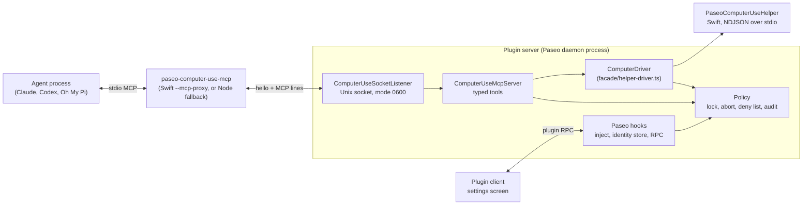

# Architecture

This document describes how the Computer Use plugin is built. The [README](../README.md)
covers what it does, the requirements, and the safety model.

## Parts

| Path | Role |
| --- | --- |
| `index.server.ts` | Plugin server entry. Resolves the state dir, builds the helper, starts the service, registers hooks and RPC handlers. |
| `index.client.tsx`, `client/settings-screen.tsx` | Plugin client entry. Registers the one settings screen. |
| `shared/settings.ts`, `shared/rpc.ts` | Settings schema and RPC contracts shared by server and client. |
| `server/paseo/` | Code that knows about Paseo: MCP server injection, the client to agent identity store, RPC handlers. |
| `server/computer-use-mcp/` | The computer use service. It never imports `@getpaseo/*`; `test/boundary.test.ts` checks this. |
| `native/macos/` | The Swift helper and its tests. |

## Startup

1. `computeHomeKey` hashes the canonical Paseo home (`PASEO_HOME`, default `~/.paseo`, resolved
   and symlinks followed). The state dir is `~/.local/state/paseo-computer-use/<key>`. Two daemons
   on different homes get different dirs; the listen address does not change the key.
2. The MCP socket is `<stateDir>/mcp.sock`, or a path under `/tmp` when that is too long for a
   Unix socket. If a socket file is already there, the listener connects to it first. A socket
   that accepts the connection belongs to another live daemon, so start fails and the status
   RPC reports `socketError`. A socket that refuses is stale and is replaced.
3. `installMcpShim` writes `<stateDir>/bin/paseo-computer-use-mcp`. It is a `/bin/sh` wrapper that
   runs the compiled helper in `--mcp-proxy` mode, or the Node shim when the helper is not built
   yet. Every path in the wrapper is single-quoted, so spaces and shell characters are safe.
4. `buildHelperBinary` compiles the embedded Swift sources
   (`server/computer-use-mcp/helper/sources.generated.ts`, written by `npm run embed:helper`)
   with `xcrun swiftc`, into `~/Library/Caches/paseo-computer-use`, keyed by a source hash.
   Build state and errors go to the status RPC.

## Injection and identity

`server.before("agent.create")` calls `addComputerUseServer`. When the setting is on and the
provider is in `injectProviders` (Claude, Codex, Oh My Pi), it adds the `paseo-computer` stdio
MCP server with a fresh client id in `PASEO_CU_CLIENT`. For Claude and Codex, read tools go into
the tool policy as preapproved; action tools do not, so a prompting provider asks before each
action. Oh My Pi's adapter does not read the tool policy, so its own permission mode decides.

The create hook has no agent id. `agent.session_open` sees both the client id (from the env)
and the agent id, and `ClientIdentityStore` saves the binding in
`<stateDir>/client-bindings.json`. The binding survives daemon restarts and archive, because a
resumed agent reconnects with the same client id.

## Request path

1. The agent starts the shim over stdio. The shim connects to the socket and sends one hello
   line (client id, provider, agent id when the env has it, pid), then copies MCP lines both ways.
2. `ComputerUseSocketListener` makes one `ComputerUseMcpServer` per connection. The caller id comes
   from the hello; the identity store maps it to the host agent id.
3. `ComputerUseMcpServer` serves `initialize`, `tools/list`, and `tools/call` with the tool table in
   `mcp/tools.ts`. Each tool has a zod input schema, a description, and MCP annotations. There is
   no code-execution tool.
4. Action tools take the one-owner `ControlLock`, check the deny list, run through `ComputerDriver`,
   wait for the UI to settle (`ActionSettler`), and return `verified` or `unverified: <reason>`
   with the new app state.
5. `ComputerDriver` sends NDJSON commands to the helper through `HelperProcess`, which starts the helper
   on demand, applies timeouts, and sends `cancel` for a timed-out or aborted command.

## Accessibility tree and element ids

The helper returns a raw tree (depth and node limits, secure fields shown as `••••••••`).
`condenseAccessibilityTree` normalizes roles, folds containers and text, and numbers the
interactive elements. `ElementIds` keeps, per app and for that app's latest read, the element signature (role, subrole,
name, frame) behind each index. An action sends that signature,
and the helper acts only when the live element still matches. Otherwise it returns
`stale_element`, so a changed or replaced element is never clicked by mistake.

## Stopping

- **Esc and mouse shake.** `UserInputEscapeMonitor` in the helper is a `CGEventTap` that is armed
  while an agent holds the lock. Esc, or three mouse reversals within 380 ms, sends an `abort` event.
  `AbortMonitor` cancels the running command and marks the caller stopped until its turn ends, so
  further calls in that turn return `aborted_by_user`.
- **Paseo Stop.** `agent.turn_ended` with outcome `canceled` cancels that agent's running command.
  When the owner cannot be matched to any host agent, any canceled turn cancels it, which fails
  toward stopping. Every turn end releases the agent's lock and clears its Esc stop.
- **Connection close and idle.** A closed connection cancels its command and releases the lock.
  An owner idle for 60 seconds loses the lock.
- **Overlay lifetime.** The overlay follows the lock. The lock's `onOwnerChanged` subscriber in
  `index.ts` sends the helper `end_turn` each time the owner becomes empty, whatever released it
  (turn end, closed connection, idle, Stop, agent close, Esc, failed arm). No other path sends
  it. A helper that exited since the owner took the lock is not asked, so a hide never starts a
  new helper.

## Helper (`native/macos`)

`PaseoComputerUseHelper/main.swift` reads NDJSON commands on stdin and runs them on a worker
queue; the main thread keeps the event tap and the overlay. `CommandCancellation` makes long
commands stop between steps.

| File | Role |
| --- | --- |
| `AXEngine.swift` | App and window lookup, tree reads, element resolution, AX messaging timeout. |
| `ElementSignature.swift` | Compares the signature the agent saw with the live element. |
| `AppBlockList.swift` | Refuses any app command whose resolved bundle id is on the list the plugin sends. A command without the list is refused. |
| `InputDriver.swift` | Window-targeted mouse and key events without moving the user's cursor, `type_text` routing, paste with full clipboard restore. |
| `PasteboardSnapshot.swift` | Captures and restores every pasteboard item and type. |
| `ScreenCapture.swift` | Window screenshot with `CGWindowListCreateImage` (loaded with `dlsym`), and a ScreenCaptureKit fallback. |
| `OverlayPresenter.swift` | The one owner of the overlay: a state machine (`hidden`, `active`, `fading`) driven by `pointerMove`, `pulse`, and `hide`, a 120 Hz main run loop frame timer, and a 5 second watchdog that hides the overlay when no hide arrives. Input actions do not wait for the animation. |
| `PointerAnimator.swift`, `MotionPhysics.swift` | One pointer glide, stepped per frame with the shared cursor physics; a new move replaces it. |
| `OverlayCoordinateSpace.swift` | Converts global display coordinates (top-left origin) to AppKit coordinates with the primary display height, correct on displays with negative origins. |
| `VirtualPointerOverlay.swift` | The AppKit surface (a halo panel with the target window's bounds and the pointer panel; click-through, nonactivating, left out of capture), the shake detector, and the Esc monitor. |
| `ProxyShim.swift` | The `--mcp-proxy` mode used by the shim. |

### Typing

`type_text` checks the current input source. With a plain keyboard layout it sends key events.
With an input method (Telex, VNI, and others, detected from the TIS id and type) it pastes the
text, because keystrokes through an input method change the text. The paste writes the text with
the `org.nspasteboard.TransientType` and `ConcealedType` markers, sends Cmd+V, waits until the
field value changes (at most 1.5 s), and then restores the snapshot. A copy the user made during
the paste is kept.

## Deny list

`policy/deny-list.ts` holds the one built-in list (password managers, Keychain Access, the login
window, SecurityAgent) plus the user's `extraBlockedBundleIds`. The plugin refuses known app
names before calling the helper, and sends the full list with every app command so the helper
checks the bundle id the name resolves to.

## Settings and RPC

Settings (`computer-use`, host scope): `enabled`, `injectProviders`, `extraBlockedBundleIds`,
`screenshots`. The server reads them once at start and follows changes through `subscribe`;
`agent.create` waits for the first read.

| RPC | Purpose |
| --- | --- |
| `computer-use.status.get` | Enabled flag, helper build state, permissions, input source, owner, audit entries, socket error. |
| `computer-use.permissions.open` | Opens the Accessibility or Screen Recording pane in System Settings. |
| `computer-use.control.stop` | Cancels the owner's running command and releases the lock. |

The settings screen is the only client UI: the enable switch with its warning, permission rows,
helper status, the provider switches, and the extra blocked apps editor.

## Tests

- `npm test` runs the Vitest suites in `test/`. On macOS, `test/e2e-real-helper.test.ts` builds
  and starts the real helper; its checks that read apps need the macOS permissions.
- `npm run test:swift` runs the helper's XCTest suites.
