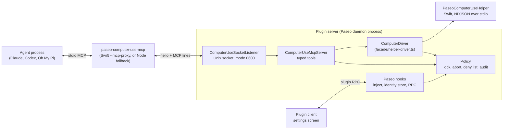

# Architecture

This document describes how the Computer Use plugin is built. The [README](../README.md)
covers what it does, the requirements, and the safety model.

## Parts

| Path | Role |
| --- | --- |
| `index.server.ts` | Plugin server entry. Resolves the state dir, builds the helper, starts the service, registers hooks and RPC handlers. |
| `index.client.tsx`, `client/settings-screen.tsx` | Plugin client entry. Registers the one settings screen. |
| `shared/settings.ts`, `shared/rpc.ts` | Settings schema and RPC contracts shared by server and client. |
| `server/paseo/` | Code that knows about Paseo: MCP server injection, the client to agent identity store, RPC handlers. |
| `server/computer-use-mcp/` | The computer use service. It never imports `@getpaseo/*`; `test/boundary.test.ts` checks this. |
| `native/macos/` | The Swift helper and its tests. |

## Startup

1. `computeHomeKey` hashes the canonical Paseo home (`PASEO_HOME`, default `~/.paseo`, resolved
   and symlinks followed). The state dir is `~/.local/state/paseo-computer-use/<key>`. Two daemons
   on different homes get different dirs; the listen address does not change the key.
2. The MCP socket is `<stateDir>/mcp.sock`, or a path under `/tmp` when that is too long for a
   Unix socket. If a socket file is already there, the listener connects to it first. A socket
   that accepts the connection belongs to another live daemon, so start fails and the status
   RPC reports `socketError`. A socket that refuses is stale and is replaced.
3. `installMcpShim` writes `<stateDir>/bin/paseo-computer-use-mcp`. It is a `/bin/sh` wrapper that
   runs the compiled helper in `--mcp-proxy` mode, or the Node shim when the helper is not built
   yet. Every path in the wrapper is single-quoted, so spaces and shell characters are safe.
4. `buildHelperBinary` compiles the embedded Swift sources
   (`server/computer-use-mcp/helper/sources.generated.ts`, written by `npm run embed:helper`)
   with `xcrun swiftc`, into `~/Library/Caches/paseo-computer-use`, keyed by a source hash.
   Build state and errors go to the status RPC.

## Injection and identity

`server.before("agent.create")` calls `addComputerUseServer`. When the setting is on and the
provider is in `injectProviders` (Claude, Codex, Oh My Pi), it adds the `paseo-computer` stdio
MCP server with a fresh client id in `PASEO_CU_CLIENT`. For Claude and Codex, read tools go into
the tool policy as preapproved; action tools do not, so a prompting provider asks before each
action. Oh My Pi's adapter does not read the tool policy, so its own permission mode decides.

The create hook has no agent id. `agent.session_open` sees both the client id (from the env)
and the agent id, and `ClientIdentityStore` saves the binding in
`<stateDir>/client-bindings.json`. The binding survives daemon restarts and archive, because a
resumed agent reconnects with the same client id.

## Request path

1. The agent starts the shim over stdio. The shim connects to the socket and sends one hello
   line (client id, provider, agent id when the env has it, pid), then copies MCP lines both ways.
2. `ComputerUseSocketListener` makes one `ComputerUseMcpServer` per connection. The caller id comes
   from the hello; the identity store maps it to the host agent id.
3. `ComputerUseMcpServer` serves `initialize`, `tools/list`, and `tools/call` with the tool table in
   `mcp/tools.ts`. Each tool has a zod input schema, a description, and MCP annotations. There is
   no code-execution tool.
4. Every tool that names an app first checks the deny list and the browser rule, before the lock and
   before any helper call. Action tools then take the one-owner `ControlLock`, refuse an app that
   needs a new read after a `user_active` refusal (see User activity), run through `ComputerDriver`,
   wait for the UI to settle (`ActionSettler`), and return `verified` or `unverified: <reason>`
   with the new app state. For click, drag, scroll, key press, and secondary action, which the helper
   cannot check, the driver reads the app before the action (one extra tree read, 1.5 s at most, that does not touch the helper's element cache) and the result
   says what differs after it (`changed: ...`, or `unverified: no change seen`); `verified` always
   stands. `changed: content` is for printed content; items of a closed menu differ as `changed: menu
   items`, and a difference the printed diff does not show is not reported. A click that took an app
   from inactive to active (and changed only focus or menus, in an app with an indexed tree) adds one
   line saying it may have only activated the window; an app that stays in the background says nothing,
   because the plugin does not raise windows. In `auto` screenshot mode, a window with fewer than
   `SPARSE_TREE_ELEMENT_LIMIT` indexed elements gets a screenshot with its state. For a window with
   a web area the count covers the largest web area only, not the browser chrome around it.
5. `ComputerDriver` sends NDJSON commands to the helper through `HelperProcess`, which starts the helper
   on demand, applies timeouts, and sends `cancel` for a timed-out or aborted command.

## Windows

An app with several windows would print every window in one read (about 460 indexes for three
Chrome windows), so a read covers one window. The helper walks the menu bar and the target window,
and any sheet, popup window, or floating or modal panel that sits over it. It only lists the other
windows, as `other_windows` (id and title, no elements), and the condenser prints them on one
`Other windows:` line. Panels (window layers from 1 up to, not including, the menu bar layer) that do
not cover the target are in that list too, so `window_id` can reach them; a panel can also be the
target. The target is the window the agent named with `window_id`, else the app's focused window,
which is always a normal window. Untitled windows are walked and listed like any other, so a prompt
(a permission or save-password bubble) stays visible. Only an untitled window that overlaps the top
of the target, has children of no role other than list, row, cell, or static text, and is below the
modal layer (a browser's address suggestions; `WindowScope.isSuggestionDropdown`) is left out of the
change report: the helper does not list it in `other_windows` and names its id in `dropdown_windows`,
which `appWindows` skips, so it never counts as a window that opened or closed. A walked one keeps
its content in the read. The role set is assumed from how such a dropdown is built, not observed on
a live system. A change report (`describeChange`) lists each window that opened or closed and a
title change, one per line, up to four.
Normal window ids are the ones `list_windows` shows (`AXEngine.reportableWindows`); an AX window is
tied to its id with `_AXUIElementGetWindow`, looked up at run time, with a frame and title match as
the fallback. When that fallback cannot tell the windows apart (same frame, no title) and the target
is not found, the read fails with an error instead of returning an empty tree.
Titles are the window server's, which have no profile suffix; the AX title stands in when Screen
Recording is not granted.

The window of the agent's last read of an app (any read it asked for) is the window every later
action and background read uses. A `query` read that names no `window_id` searches that window and
does not change it. The driver sends it as `windowId` on every
helper command, so the helper never picks a window after the agent read. The agent can name another
window with `window_id` on an action. An element index belongs to the window that read numbered, so
naming another window with an index is `stale_element`. A window that is closed, minimized, on
another Space, or not the app's fails the command with `window_gone`; nothing is sent to another
window. The read after an action keeps the same window. If the action closed it, that read answers
`changed: window closed [id] "title"` with no tree, and the next action fails with `window_gone`.
A closing window can still be listed, with no elements, at the first read and be gone at the read
for the image of the sparse tree, so every read made for the result of an action maps `window_gone`
to the same answer. When the app's focus moved to another window during the action, the result adds
`focused window is now [id] "title"` (the helper reports the app's focused window with every read);
the target does not change. The helper lists the app's windows before it walks the tree and reads
the focused window after it, so a window that opens during the walk (Command+n) can be focused but
not listed. The read after an action then reads again, up to 3 times 100 ms apart, so the change
says `window opened` and the `Other windows:` line names it.

## User focus

The plugin must not change what the user is working in. The helper never activates, hides, or deactivates the target app, never writes `AXRaise`, `AXMain`, or `AXFrontmost` on a target window, and never moves
or resizes a window. The only `AXRaise` it sends is to the user's own window after a restore, described below. `secondary_action` refuses `AXRaise`. `FrontmostGuard` reads the frontmost app
before and after every action that sends input or changes an element (click, drag, scroll,
`press_key`, `type_text`, `paste_text`, `set_value`, `select_text`, `secondary_action`), with a short
settle in between for an app that activates itself. When the pid differs, the result gets
`userFocusChanged: "user_focus_changed: <old> -> <new>"`, the tool result prints it first, and the audit
entry keeps it. Two instances of one app print as `Name (pid N)`. A change that shows only after the
settle says so in the line. The guard keeps the app in front when the last action ended, so a change
that came after the settle is reported as `(since the previous action)` at the next action; it can
also be the user's own switch. A cancel during the settle does not discard the finished action's
result. An action that fails after the app in front changed has no result to carry the line, so the
helper error carries it and the audit entry of the failed action keeps it.

`FocusWatch` is the restore, and it restores only when the action caused the change. Before the
settle, `FrontmostGuard` starts a watch on the main thread that reads the frontmost app every 20 ms
for 2 s, and also on each `NSWorkspace.didActivateApplicationNotification`. Two readers
(`FrontmostGuard.FrontReader`) give the app in front, and only regular apps count (a system panel
such as Spotlight or Control Center never is the user's app). `FrontmostGuard.frontmost` is
`NSWorkspace.frontmostApplication`, and it is the only answer any decision uses: the reads before and
after the action, the keyboard baseline, the user activity check, and every outcome of the watch.
When it has no regular app (a launcher such as Alfred, a system panel), the user's app is unknown:
no `user_focus_changed` line to or from `none`, no watch when it is so before the action, and no key
give-back while it is so during a watch. The audit detail records the change as
`front_app_unknown: <old> -> <new>`, and the next action compares with the last app that was known.
`FrontmostGuard.windowServerFront` asks the window server for its front process
(`_SLPSGetFrontProcess` and `GetProcessPID`, looked up with `dlsym`), which changes the moment an app
comes forward. The plugin posts window server records to the target on every click and key action,
and it is not confirmed that they leave the window server's front process alone, so the watch uses
that reader only to look sooner: a change it sees is acted on, or printed, only once AppKit agrees.
When AppKit never agrees, the watch ends with nothing done and no line. The action's result is not
held back: it returns after the settle, and the watch ends later. When an app other than the one that was in front before the action takes the focus, the watch
looks at which app it is. The target of the action (its pid is resolved when the action starts) or a
process whose launch date is after the action start is a candidate. Any other app ends the watch with
`(not restored: another app took focus)`. For a candidate, the watch looks once more one poll later
(same app in front, AppKit agrees, no user input, not stopped), then runs `FocusCorrection.bringBack`
once per action and waits up to 300 ms for AppKit to show the earlier app in front. The correction
reads the user's window again (outside the hold), holds screen updates
(`ScreenUpdateGate`: `SLSDisableUpdate` and `SLSReenableUpdate` on the helper's connection), posts the
action's synthetic activation records to the target again (`InputDriver` keeps the window and records
of its last activation), asks the window server to bring the user's window to the front
(`_SLPSSetFrontProcessWithOptions` with the window id) and posts the key window records to it, and
releases the hold. The 300 ms wait, and the 100 ms before the fallback below, count from the end of
these steps, so a step that stalls up to the hold cap does not use them up. Without the window request, or without a known user window, it calls
`NSRunningApplication.activate` on the earlier app instead; a window request that was accepted but
has not shown after 100 ms is followed by that activation once, and only when neither reader shows
the earlier app in front. The hold is released when the steps end, normally or with an error, or by
a watchdog 250 ms after it began; the window server counts holds, so only the first of the two
releases. The watchdog fires on its own queue, so a step that stalls the main thread does not keep
the hold. These private calls do not say they are safe from two threads at once, so every private
window server call of the helper (the front process read, the window request, the hold and its
release, and `InputDriver`'s activation and key window records from the command thread) takes one
lock (`WindowServerCalls`) for its own length. No caller holds it across other work or a wait for
another thread, so the watchdog release waits at most for one call in flight and never runs at the
same time as another. The audit has the hold measured to the end of its release and whether it
passed the cap. When the hold calls are missing, or the window server refuses the
hold, the steps run without it. After the earlier app is in front, the user's window gets `AXRaise`
only when another window of its app is above it in the window list, and never after the watch was
stopped. The user's window is read right before the request, not at the action start, so a window
the user's app opened since is not put behind an older one: the app's `AXFocusedWindow` (with a
100 ms messaging timeout on that app's element), else its topmost normal window on screen.
Hardware input that can switch apps means the user did it, and the line says `(user switched apps)`.
Only key downs, modifier changes (`flagsChanged`), and left, right, or other mouse downs and ups
count, read per event type with `CGEventSource.secondsSinceLastEventType` on `.hidSystemState`.
Pointer moves, drags, the scroll wheel, and trackpad gestures do not: a person reading on the Mac
moves the pointer all the time, and with any input counted a target that a key brought forward was
left in front. The idle clocks do not say which modifier changed or which modifiers a key down had,
so the watch also samples `CGEventSource.flagsState(.hidSystemState)` for Command, Control, or Option
when the action starts and at every poll. For the target, a modifier change after the action started
counts when one of those was seen held: that is the release of Command that ends a Command+Tab begun
before the action, while Shift for a capital letter is not. A key down after the action started
counts only with one of those seen held (`FocusWatch.keyDownRule`): a user typing a prompt in Paseo
while the target takes focus gets Paseo back, and the keys do not go to the target. The other choice
of that constant counts every key down and leaves the target in front of a typing user. The cost of
the default: a plain key that switches apps, and a chord that starts and ends between the action start
and the first poll, are not seen, so such a switch to the target within the watch can be undone. The
latest mouse down or up counts from 300 ms before the earliest moment the target can have come to the
front (the last poll that saw the earlier app, or the action start) until the check: that is the
click that brought it forward (the Dock switches on the mouse up, and a slow app comes forward well
after the down), or a click in it. An earlier click cannot explain the switch and does not stop the
restore. For a launched process, a key down or a mouse down or up from one second before the action
started counts, so an app the user opened from the Dock or a launcher just before is left alone.
The idle times and the modifier sample of the deciding check go to the audit entry as
`focusWatchDetail` (`focus_watch: <outcome> key_down_idle=… flags_changed_idle=… mouse_down_idle=…
mouse_up_idle=… switch_modifier_seen=… checked_after_action=… front_from_after_action=…`) and never
to the agent, so live QA can tell real input from a false positive. A trackpad gesture that switches
to the target is not seen and can be undone. The combined session clock is not used: the plugin's own key presses can reset it, and a
target that a key brought forward (Command+n) was then left in front as `(user switched apps)`. The HID
clock does not see input that software posts for the user (Voice Control, a remote screen session),
so a switch to the target made that way within the watch can be undone; a switch to an app that was
already running and is not the target never is. The outcome is kept in
the guard with the caller of the action (the plugin sends `meta.callerId` with each action) and
printed in the result of the action that caused it when the watch ended during the settle wait (the watch starts before the wait, which is 60 ms, so only a restore asked for within about three polls can make it), and otherwise at that caller's next action, as `user_focus_changed: <old> -> <new> (restored after N ms)`,
`(could not restore)`, `(user switched apps)`, `(not restored: another app took focus)`, or
`(stopped; the restore may still apply)`, which also goes to that action's audit entry. `N` counts
from the start of the watch. The audit detail also names the correction steps that ran:
`gate_held_ms=… gate_over_cap=… gate_released_by=body|watchdog|none restore_path=front_process|activate|front_process_then_activate|key_records|key_records_then_front_process|key_records_then_activate|none target_reasserted=… key_focus_returned=… user_window_raised=…`.

The watch also gives back the keyboard. The guard reads, before the action, which app the keys go to
(the system-wide `AXFocusedApplication`) and the user's window. When the keys were with the user's
app, the watch reads the holder again every 100 ms while the user's app stays in front, and on each
poll for the second look and while it waits for the keys to come back. The holder is read on a
queue of its own and the main thread waits at most 50 ms for it; a read that does not answer, or one
asked while a hung read still runs, gives no holder and no correction. A holder that
is the target or a process the action launched, seen on two reads in a row with no user input that
explains it (the same `userActed` rule, timed from the last read that saw the user's app hold the
keys), gets `FocusCorrection.returnKeyFocus`: the key window records for the user's window, read again
right before, and nothing else. The user's app is in front, and a front request or an activation sent
to it can close the menu, popover, or completion list the user has open there. The window request
follows once, after 100 ms, only when the keys stayed with that app, AppKit says that app also took
the front, and no user input explains it (else the public activation of the user's app). A third app
in front gets nothing. `press_key`, `type_text`, and `paste_text` post the key window records to the
target themselves, so the system-wide focused application can follow them while the user's app stays
in front; after those actions the keys are given back only when the holder is the target and AppKit
says the user's app lost the front. It holds no screen updates and never activates the target. The line is
`user_focus_changed: key focus <old> -> <new>` with `(returned after N ms)`, `(could not return)`,
`(user moved the keyboard focus)`, or `(stopped; the return may still apply)`. A holder that is any
other process (a system panel, another app of the user's) is left alone. One watch corrects at most
once, the front or the keys. The system-wide element never gets a messaging timeout of its own,
because a timeout set on it applies to every element of the process.

The next action waits up to 0.5 s for a restore that was already asked for before it ends the old
watch, so the restored app arriving is not taken for a change to undo. `end_turn`, an abort, and
`abort_tap.disarm` stop the watch and bump a stop generation; an action that began before the bump,
or whose command was cancelled, starts no watch. A stop cannot take back an activation that was
already sent, which is why the last line says the restore may still apply. Limits: the other app is
in front for at least two polls, and until AppKit reports it, before it is restored, so a flash can
still show when the hold is missing or does not cover other apps' windows, and macOS may refuse an
activation from a background (`.accessory`) process, which gives `(could not restore)`. The public
`NSDisableScreenUpdates` holds only the calling process's own windows, so it cannot stand in for the
private hold. Every window server call here is private:
whether the hold covers other apps' windows, whether the window request is accepted from the helper,
and whether the system-wide focused application shows a window that takes the keys without
activating its app are unconfirmed until live QA.

Two mechanisms cannot be shown to leave the frontmost app alone by reading the code, because they
post private window server records: `focusWithoutRaise` before a click or drag, and the key window
records of `focusKeyWindow`. They stay behind the frontmost check above. The helper also sets
`AXFocused` on the target element for `type_text`, `paste_text`, and `set_value`, which moves focus
inside the target app only. `type_text` and `paste_text` send nothing unless the app then reports
that element, or one inside it, as its focused element (`unverified: could not focus element`).

The key window step posts the key window records again on each of up to 15 polls (20 ms apart) and
reads `AXFocusedWindow`. A cancel is checked before each accessibility request, and the whole step
ends after 1.5 s, even in the middle of a poll, with `(the app did not answer in time)`: each request
can block for the 1 s messaging timeout, and a hung app would otherwise hold the command and the
control lock for many seconds. An app that is not in front can answer nothing or a stale window, because
AppKit has no key window for an inactive app. The target window's own `AXFocused` and `AXMain` then
decide (`AXEngine.targetHoldsKey`); a panel or sheet of another window that holds the keys is never
set aside. The refusal names what the app reported, so a live run shows which of the cases it was,
and tells the agent to act on the window's elements (`click`, `secondary_action`, `set_value`) or ask
the user. Re-posting the records does not move the key window of an inactive Chrome. For Command+w
alone, a refused window is closed with `AXPress` on a close button (no event, no activation), and
that button must close no more than Command+w would. Command+w closes one tab in a window with tabs,
while the window's `AXCloseButton` closes all of them, and Chrome does not ask. `CloseControl`
decides: a window with no tab bar or one tab uses its enabled `AXCloseButton`; with more tabs, the
selected tab's own `AXButton` named `Close` or `Close Tab` is pressed; with no single such button,
nothing is pressed and the refusal stands. A tab bar is an `AXTabGroup` or an element with
`AXTabButton` children. The window is read without its `AXWebArea`s first, because a browser's tab
strip is part of its own interface and a tab list inside a page does not change what Command+w
closes; only when that finds no tab bar are the web areas read, for an Electron app that draws its
tabs in one. The read stops at 2,000 elements or 1.5 s and then refuses. One known gap: an app whose
Command+w closes an inner tab that is not shown as a tab bar (VS Code with one editor open) gets its
window closed. After a window press, the helper waits up to 500 ms for the window to leave the
screen: `changed: window closed [id] "title" (closed with its close button)`, or `unverified: pressed
the close button of window [id]; the window is still open` (for example a save prompt). When the
window closes after that wait, the read after the action shows it closed and the plugin prints the
closed line instead. A tab press waits for the button to go away: `unverified: closed the selected
tab of window [id] with its close button`, or `...; the tab is still open`. A press that times out
(`.cannotComplete`) may still take effect, so it counts as pressed: `unverified: close button
pressed, window state unknown`, unless the window is then seen gone.

## User activity

The plugin does not act in an app while the user is working in that app. The agent is meant to
work in a background app while the user keeps working in their own, so input to any other app,
Paseo included (an approval click or Return), never pauses an action. When an action command
starts, before it sends anything, `UserActivity.check` in the helper resolves the target's pid and
reads the hardware idle clocks (`.hidSystemState`, through `FocusWatch.hardwareIdleSeconds`) for
the last key down, the last left, right, or other mouse down, and the last scroll. Input within
`UserActivity.pauseSeconds` (3 s, a first value to tune in live QA) counts only when it went to
the target:

- A key down goes to the frontmost app. It counts when the target is the frontmost app now, or
  was when the key was pressed. `UserInputLog` keeps the time of each workspace activation notice,
  which gives the frontmost app at an earlier moment; for a key from before the log started only
  the frontmost app now counts. The clock gives only the latest key down.
- A mouse down or scroll goes to the window under the pointer, in front or not. `UserInputLog`
  runs a listen-only session tap for mouse downs and scrolls only, on its own thread, while an
  agent holds control (see below). It keeps the time and location of each hardware event (no
  source pid, no plugin marker) for 4 s, with the frames and owner pids of the on-screen windows
  at that location when the event came (from a window list read at most every 50 ms). An input
  counts when the frontmost of those windows, leaving out the helper's own overlay and clear
  windows, belongs to the target. The frontmost window decides, so a click on a Paseo window that
  covers the target does not count. A window that moved or closed after the click does not change
  where the click went.
- When the log cannot account for the latest pointer input (the tap did not run for the whole
  window, or its newest record is older than the clock's), or the frontmost window at a location
  belongs to a process that is not an app (the window server's menu bar strip, whose clicks go
  to the frontmost app's menus), the location is unknown and the input counts only when the
  target is frontmost. The log starts when an agent takes control, so the actions in the first
  `pauseSeconds` of each control period take this path.

`UserInputLog` (the tap and the activation observer) runs only while an agent holds the lock,
which it can take only while Computer Use is on. `ControlInputWatch` starts it when the helper
arms the Escape tap (`abort_tap.arm`, sent by `ControlLock.acquire`, which only mutating tools
call after the `enabled` check) and stops it on `abort_tap.disarm` (every release: turn end, Stop,
closed connection, idle timeout, agent close) and at once on Escape or a shake. A stop drops every
record. `status`, the settings screen, and read tools never start it. Turning the setting off does
not release the lock: the next action is refused, and the lock and the log end at the turn end or
the idle timeout. `end_turn` does not stop the log: the helper process sends `end_turn` on a
turn-id change without a release, and no re-arm would follow.

When input counts, the command fails with `user_active` and a message that names the app and
tells the agent to wait, read again, and retry. Read commands are never refused, so
`get_app_state` and `wait_for` keep working. The clocks need no tap, so they also see input from
before the agent took the lock, which the Escape tap (armed only while an agent holds the lock)
cannot. The plugin posts its events from a private source to one process, and they never reset
these clocks or reach the log. Pointer moves, drags, mouse ups, and modifier changes do not count:
a person reading on the Mac moves the pointer all the time. The tap sees no key events, so it
needs no Input Monitoring permission.

The rule that fired and the idle times go to the error as `userActivityDetail` and from there to
the audit entry only; the agent's text has no numbers. After a `user_active` refusal the driver (`facade/helper-driver.ts`)
marks the app and drops the state and the image kept for the refused action. The next action on
that app fails with `stale_state` in the plugin, before the pre-action reads and any helper call,
until the agent asks for a `get_app_state` of that app that starts after the refusal: the user may
have changed the app, so the agent's numbering is not trusted. A counter orders refusals and reads,
so a read that was already running when the action was refused does not count. The polls of a wait
and the read after an action never clear the mark. The audit entry of either refusal has the status
`refused` and the code in `refusal`.

## Accessibility tree and element ids

The helper returns a raw tree (depth and node limits, secure fields shown as `••••••••`).
`condenseAccessibilityTree` normalizes roles, folds containers and text, and numbers the
interactive elements. `ElementIds` keeps, per app and for that app's latest read, the element signature (role, subrole,
name, frame) behind each index. An action sends that signature,
and the helper acts only when the live element still matches. Otherwise it returns
`stale_element`, so a changed or replaced element is never clicked by mistake.

## Helper element cache

The helper keeps, per app, the element each id named and the window of the agent's last
`get_app_state`. Actions resolve against it, so the agent's index means what it saw. The cache is one
slot per app, shared by every agent, so an action that names a window other than the cached one
cannot use an element from it (`stale_element`). A read the agent
did not ask for (the state before an action, the polls of a wait, the screenshot read of a sparse
tree) sends `cache: false` and leaves it alone.

## Waiting

`wait_for` is one read-only policy call: one deny-list check, one abort signal, one audit entry,
no control lock. `wait/poll-loop.ts` polls every 300 ms through a probe from the driver
(`ComputerDriver.waitFor`), with an injectable clock for tests. Tree conditions are matched in
TypeScript on the raw tree (`wait/matcher.ts`); the value of a secure field is never read. Visual
conditions use the helper's `capture.signature`, a 64x40 grayscale thumbnail of the window or a
region of it. A wait watches the window the agent named, else the window of its last read, for tree
and image conditions alike; if that window closes the wait ends with `window_gone`.
`wait/signature.ts` compares two thumbnails and holds the thresholds. The full
image never leaves the helper. A wait never changes the numbering the agent last read: a
matched element gets the index that read gave it, or none (the result says to call
`get_app_state`). Each read gets the time left in the wait, so a hung app cannot stretch it.
`capture.signature` fails with `permission_missing` or an invalid-region error, which end the wait;
a failed capture or a timed-out read only fails that poll.

MCP calls run one after another, so an action and its settle time finish before a wait starts, and
a `visual_changed` that waited for a change would miss it. In an app whose last read was sparse,
the driver therefore takes a whole-window signature before each action. `visual_changed` compares
with that signature when it is under 30 seconds old and shows the same window, and says which
baseline it used (`baseline`: `before_last_action` or `wait_start`). One wait uses a baseline once,
and a `get_app_state` the agent asks for drops it, so a later wait looks for a new change.

## Stopping

- **Esc and mouse shake.** `UserInputEscapeMonitor` in the helper is a `CGEventTap` that is armed
  while an agent holds the lock. Esc, or three mouse reversals within 380 ms, sends an `abort` event.
  `AbortMonitor` cancels the running command and marks the caller stopped until its turn ends, so
  further calls in that turn return `aborted_by_user`.
- **Escape during `wait_for`.** The wait takes no lock, and the Escape tap is armed only while an
  agent holds the lock. Escape ends a wait only for the agent that holds the lock (after an
  action, until the 60 second idle release; a wait does not extend it). Any other wait ends with
  Paseo Stop or the end of the turn.
- **Paseo Stop.** `agent.turn_ended` with outcome `canceled` cancels that agent's running command.
  When the owner cannot be matched to any host agent, any canceled turn cancels it, which fails
  toward stopping. Every turn end releases the agent's lock and clears its Esc stop.
- **Connection close and idle.** A closed connection cancels its command and releases the lock.
  An owner idle for 60 seconds loses the lock.
- **Overlay lifetime.** The overlay follows the lock. The lock's `onOwnerChanged` subscriber in
  `index.ts` sends the helper `end_turn` each time the owner becomes empty, whatever released it
  (turn end, closed connection, idle, Stop, agent close, Esc, failed arm). No other path sends
  it. A helper that exited since the owner took the lock is not asked, so a hide never starts a
  new helper.

## Helper (`native/macos`)

`PaseoComputerUseHelper/main.swift` reads NDJSON commands on stdin and runs them on a worker
queue; the main thread keeps the Escape event tap and the overlay. `CommandCancellation` makes long
commands stop between steps.

| File | Role |
| --- | --- |
| `AXEngine.swift` | App and window lookup, tree reads, element resolution, AX messaging timeout. |
| `ElementSignature.swift` | Compares the signature the agent saw with the live element. |
| `AppBlockList.swift` | Refuses any app command whose resolved bundle id is on the list the plugin sends. A command without the list is refused. |
| `InputDriver.swift` | Window-targeted mouse and key events without moving the user's cursor, `type_text` routing, paste with full clipboard restore. `press_key`, `type_text`, and `paste_text` (and the paste `type_text` uses for an input method) share one keyboard prelude, `focusKeyWindow`. It makes the target window the app's key window without raising it, so key equivalents that act on the key window (Close Window, Save) work in an app that is not in front, then waits until the app reports that window as its AXFocusedWindow (or a sheet of it, or an app-modal panel above it). When it does not, nothing is sent and the result is `unverified: could not focus window [id]`; the key never goes to another window the app has as key. The one exception is Command+w alone, which presses a close button with `AXPress` instead (`closeWindowWithButton`): the window's, or the selected tab's when the window has more than one tab (`CloseControl.swift`). An app that does not report AXFocusedWindow at all (Java, Qt, some Electron builds) gets the keys when the target is its only normal window. Without a named window, a closed window of the last read is `window_gone`. During a long `type_text` the focused window is checked again every 64 characters; if the app moved to another window, typing stops with `user_active` (the user is probably using the app, so the agent reads again and types the rest; its turn goes on) and the count of characters typed. |
| `CloseControl.swift` | Decides which close button stands for Command+w in a window that could not be made key: the window's own with no tab bar or one tab, the selected tab's with more, or none. It reads the tree through closures, so tests use fake trees. |
| `FrontmostGuard.swift` | Reads the frontmost regular app (AppKit's for every decision, the window server's front process only to look sooner, both on the main thread) and the user's keyboard around an action, and reports a change as `user_focus_changed`. |
| `UserActivity.swift` | Refuses an action command with `user_active` when the hardware idle clocks show a key down, mouse down, or scroll within the pause window that went to the target app. |
| `UserInputLog.swift` | Keeps the time, location, and windows under recent hardware mouse downs and scrolls (a listen-only tap on its own thread) and the times of app activations, so `UserActivity` can tell which app input went to. Runs only while an agent holds control; a stop drops every record. |
| `ControlInputWatch.swift` | Starts the input log when `abort_tap.arm` arms the Escape tap, and stops it on `abort_tap.disarm` and on Escape or a shake. |
| `FocusWatch.swift` | Polls the frontmost app every 20 ms for 2 s after an action (and on each activation notice), and the holder of the keyboard every 100 ms. Corrects once when the action's own app (or a process it launched) took the front or the keys and AppKit agrees, unless hardware input explains the change: a key down or modifier release with Command, Control, or Option seen held, or a mouse down or up. |
| `FocusCorrection.swift` | The correction steps and their audit record: screen hold, synthetic activation posted to the target again, window request and key window records for the user's window (read again right before), activation fallback, `AXRaise` of a buried user window, key focus give-back with the key window records first. |
| `ScreenUpdateGate.swift` | Holds screen updates for a cap of 250 ms; released once, by the end of the steps or by a watchdog on its own queue, and reports the measured hold. |
| `WindowServer.swift` | Run-time lookups of the private window server calls (front process, window request, screen hold); each one is optional. `WindowServerCalls` is the one lock every private window server call of the helper takes. |
| `KeyFocus.swift` | Live reads of the keyboard holder (on its own queue, waited for at most 50 ms) and the user's key window, and the `AXRaise` of the user's window. |
| `PasteboardSnapshot.swift` | Captures and restores every pasteboard item and type. |
| `ScreenCapture.swift` | Window screenshot with `CGWindowListCreateImage` (loaded with `dlsym`), and a ScreenCaptureKit fallback. The same capture, before the pointer mark is drawn, feeds `capture.signature`. |
| `CaptureSignature.swift` | Downscales a window image (or a region in window points) to a 64x40 grayscale signature. |
| `OverlayPresenter.swift` | The one owner of the overlay: a state machine (`hidden`, `active`, `fading`) driven by `pointerMove`, `pulse`, and `hide`, a 120 Hz main run loop frame timer, and a 5 second watchdog that hides the overlay when no hide arrives. Input actions do not wait for the animation. |
| `PointerAnimator.swift`, `MotionPhysics.swift` | One pointer glide, stepped per frame with the shared cursor physics; a new move replaces it. |
| `OverlayCoordinateSpace.swift` | Converts global display coordinates (top-left origin) to AppKit coordinates with the primary display height, correct on displays with negative origins. |
| `VirtualPointerOverlay.swift` | The AppKit surface (a halo panel with the target window's bounds and the pointer panel; click-through, nonactivating, left out of capture), the shake detector, and the Esc monitor. |
| `ProxyShim.swift` | The `--mcp-proxy` mode used by the shim. |

### Typing

`type_text` checks the current input source. With a plain keyboard layout it sends key events.
With an input method (Telex, VNI, and others, detected from the TIS id and type) it pastes the
text, because keystrokes through an input method change the text. The paste writes the text with
the `org.nspasteboard.TransientType` and `ConcealedType` markers, sends Cmd+V, waits until the
field value changes (at most 1.5 s), and then restores the snapshot. A copy the user made during
the paste is kept.

## Deny list

`policy/deny-list.ts` holds the one built-in list (password managers, Keychain Access, the login
window, SecurityAgent) plus the user's `extraBlockedBundleIds`. The plugin refuses known app
names before calling the helper, and sends the full list with every app command so the helper
checks the bundle id the name resolves to.

## Web browsers

Web pages go to Paseo's browser tools, which work in Paseo's own browser in the background. A
browser in the background brings itself to the front for window and tab shortcuts, so Computer
Use leaves browsers alone unless the `allowBrowserApps` setting is on. `policy/browsers.ts` holds
the one list: bundle ids, display names, and the bundle id prefixes of Chrome and Safari web apps.
A name that other apps can also have (Arc, Dia, Orion, Zen) is left out, so only the bundle id the
helper resolves refuses that browser.

`withComputerUsePolicy` refuses a listed browser with `use_browser_tools` before the lock and
before any helper call; `list_apps` and `list_windows` pass `listing` and still list browsers. The
driver adds the browser bundle ids (`blockedBundleIds`) and the web app prefixes
(`blockedBundleIdPrefixes`) to every other app command, so the helper also refuses a partial name
such as `chrome`. The helper's `app_blocked` error carries the refused id in `bundleId`; the driver
turns a refused browser id into `use_browser_tools` and never reads the message text.

A browser the user put on the extra blocked list stays `app_blocked`, by bundle id or display name,
whether `allowBrowserApps` is on or off.

The refusal tells the agent to ask the user to turn on Paseo's browser tools or to allow web
browsers in Computer Use settings, because Paseo registers its browser tools only when the host
turns them on.

## Settings and RPC

Settings (`computer-use`, host scope): `enabled`, `injectProviders`, `extraBlockedBundleIds`,
`screenshots`, `allowBrowserApps`. The server reads them once at start and follows changes through `subscribe`;
`agent.create` waits for the first read.

| RPC | Purpose |
| --- | --- |
| `computer-use.status.get` | Enabled flag, helper build state, permissions, input source, owner, audit entries, socket error. |
| `computer-use.permissions.open` | Opens the Accessibility or Screen Recording pane in System Settings. |
| `computer-use.control.stop` | Cancels the owner's running command and releases the lock. |

The settings screen is the only client UI: the enable switch with its warning, the web browser
switch, permission rows, helper status, the provider switches, and the extra blocked apps editor.

## Tests

- `npm test` runs the Vitest suites in `test/`. On macOS, `test/e2e-real-helper.test.ts` builds
  and starts the real helper; its checks that read apps need the macOS permissions.
- `npm run test:swift` runs the helper's XCTest suites.
